<h1 align="center">Hey 👋 Eu sou o Daniel Cherutti</h1>

  

  Desenvolvedor full-stack · soluções SaaS para negócios · <a href="https://danielcherutti.github.io/website/">danielcherutti.github.io</a>

---

## Stack

  
  
  
  

  
  
  
  
  
  

---

## Stats

  
  

---

## Conecte-se

  
  
  

---

  
  

 

<picture>
  <source media="(prefers-color-scheme: dark)" srcset="https://raw.githubusercontent.com/DanielCherutti/DanielCherutti/pacman-output/pacman-contribution-graph-dark.svg">
  <source media="(prefers-color-scheme: light)" srcset="https://raw.githubusercontent.com/DanielCherutti/DanielCherutti/pacman-output/pacman-contribution-graph.svg">
  
</picture>
